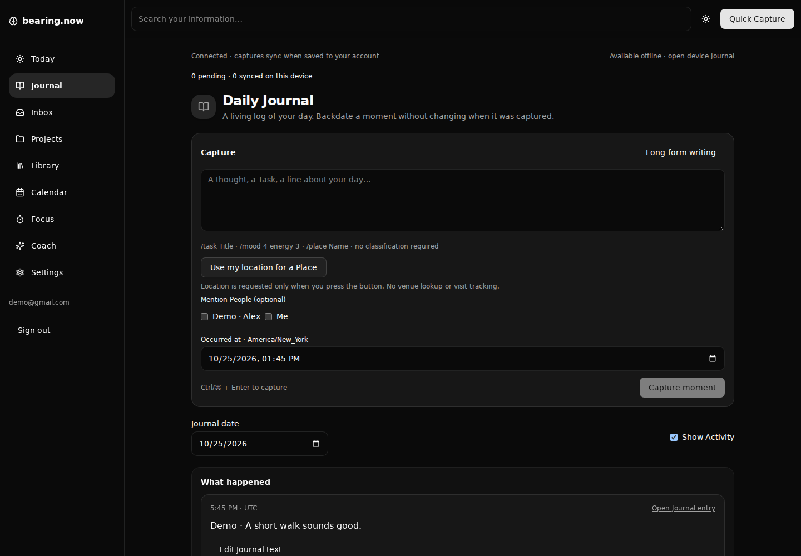

# Bearing — capture, connect and recall

An open-source, self-hostable personal knowledge workspace built with Next.js 16,
React 19, TypeScript, Prisma and PostgreSQL. V1 reuses the existing auth, editors,
audit and draft protections while introducing a connected information model.

## What works in V1

- Quick Capture, Inbox and a chronological Daily Journal with references to real Items.
- Seven Item kinds: Task, Note, Habit, Event, Goal, Person and Bookmark. Routine is
  a Habit template with a simple Markdown checklist; Me is one canonical Person.
- Optional Projects, Areas/Tags, typed Links, keyword Search, Calendar/Agenda and Graph.
- Task recurrence, independent Habit occurrence checklists, multiple mood check-ins,
  guided Reviews and Focus sessions persisted as Activity.
- Per-account offline text capture after a prior authenticated visit, with an IndexedDB
  outbox, automatic reconnect sync, retry states and server idempotency.
- Conversational Coach using a server-configured OpenRouter or Vercel AI Gateway
  model: owned-record evidence, clarification, editable approved atomic change batches,
  saved/temporary conversations and explicit editable memory.
- Invitation-only accounts, revision checks, editor leases, audited writes, per-account
  optional demo examples and full V1 JSON export/clear/restore in Settings.



There is no public shared-demo login. A hosted deployment must be provisioned by its
operator. Sign in with your own account; a new account requires an invitation.
After sign-in, Settings → Add demo data explicitly creates examples in your account.
Repeat setup is idempotent. Remove demo data preserves real/other-account data and
refuses removal when edited examples or personal references need reconciliation.

## Local setup

Requires **Node.js 22+**, npm and PostgreSQL 16 (external PostgreSQL for Vercel).
Use a disposable local database first. This repository has two additive migration
histories; V1 deployment is deliberately separate from the ordinary build.

```bash
git clone https://github.com/papa-mike-delta/bearing-now.git
cd bearing-now
npm ci
cp .env.example .env
# Edit DATABASE_URL and set SESSION_SECRET to a unique random value (32+ characters).
# Generate a secret with: openssl rand -hex 32
npm run db:generate
npx prisma migrate deploy
# Review prisma/v1/migrations before explicitly applying V1 tables:
BEARING_V1_SCHEMA_REVIEWED=yes npm run db:v1:deploy
# Set BEARING_V1_ENABLED=true in .env, then:
npm run db:invite -- you@example.com
npm run dev
```

Open `/login`, choose Create account and use the email-bound invitation. No seed
runs at boot or failed login. The new account contains only Me. Use Settings for
optional fictional examples. The old `/api/seed` and legacy CLI seed are disabled
when V1 is enabled; never reset the database to repair demo access.

## Configuration and deployment

| Variable | Purpose |
| --- | --- |
| `DATABASE_URL` | Private PostgreSQL connection; use TLS as required by your provider |
| `SESSION_SECRET` | Unique server signing key, minimum 32 characters in production |
| `BEARING_V1_ENABLED=true` | Enable V1 routes after both migration sets are applied |
| `BEARING_COACH_PROVIDER` | `openrouter` or `gateway`; optional Coach configuration |
| `BEARING_COACH_MODEL` | Model identifier supported by the selected provider |
| `OPENROUTER_API_KEY` / `AI_GATEWAY_API_KEY` | Server-only provider key |

Coach is unavailable until configured. No free built-in model is implied. The
client discloses provider/model use before sending chat. Read [Coach configuration
and privacy](docs/redesign/CONVERSATIONAL_COACH.md) before enabling it. Never expose
keys through `NEXT_PUBLIC_*` or browser settings.

For Vercel Hobby, use external PostgreSQL, Node 22+, a production session secret
and isolated preview environment variables/database. `npm run build:vercel` applies
**legacy migrations only**; an operator must explicitly apply reviewed V1 migrations
before enabling V1. See the [deploy/rollback runbook](docs/RELEASE.md). A production
migration or deployment is a separate, explicitly approved action after preview QA.
Do not use `db:push`, `migrate dev`, `db:reset` or database drops against live data.

## Privacy, offline and portability

In-app help is at `/help`; its source is [here](src/app/help/page.tsx).
Offline support covers text capture, not full editing or AI. A prior authenticated
visit is required. Browser data can be evicted: do not clear storage with pending
entries. Logout locks the account queue; sign back into that same account to sync.

Settings exports a private `bearing-v1` JSON backup of all V1 records, associations,
histories, saved conversations/preferences and audit receipts. Restore validates and
atomically replaces data in the **same account**. Audit remains append-only. Identity,
passwords, 2FA secrets, invitation tokens, leases, browser drafts/outbox and legacy
records are excluded. Sync first and keep a verified backup before clearing.
[Backup details](docs/backup-restore.md).

QR sign-in uses ephemeral, in-memory challenges: it fails closed on restart or a
worker mismatch and is not a reliable multi-worker login transport. Email/password
and verified TOTP remain the normal sign-in path. Notification delivery, uploads,
external AI research, cross-user collaboration and full offline editing are outside V1.

## Verification and contribution

```bash
npm run lint
npx tsc --noEmit --incremental false
npm test
V1_TEST_DATABASE_URL=postgresql://... npm run test:v1
RESTORE_TEST_DATABASE_URL=postgresql://... npm run test:integration
npm run build
# Browser release suite; disposable DB only, see e2e/README.md:
V1_TEST_DATABASE_URL=postgresql://... npm run test:e2e:release
```

Database suites create and drop randomly named isolated schemas. Browser suites use
a separately provisioned disposable database and may mutate/reset test accounts.
Never supply live credentials to test commands. See [CONTRIBUTING](CONTRIBUTING.md),
[architecture](docs/ARCHITECTURE.md), [release matrix](docs/RELEASE.md), and the
[approved V1 specification](docs/redesign/BEARING_V1_SPEC.md).

MIT licensed. Original project by karim-coder; developed by Bearing contributors.
